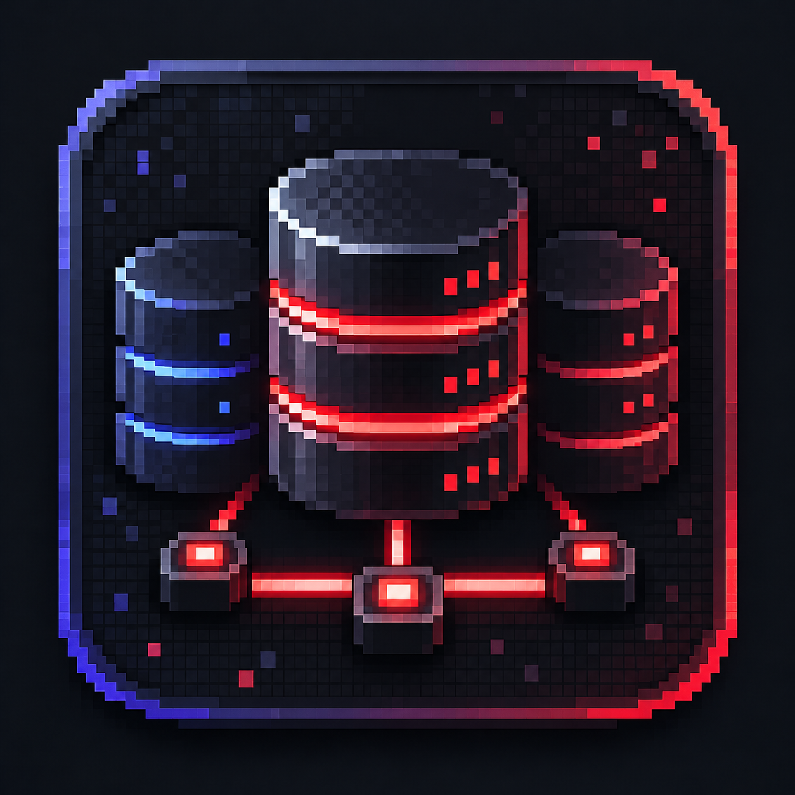

<div align="center">
  
  <h1>SQL Hub</h1>
  <p><strong>Open-Source Cross-Platform Desktop-App (Windows, macOS &amp; Linux) im Pixel-Launcher-Design zur Verwaltung mehrerer Datenbank-Instanzen (phpMyAdmin, Adminer, pgAdmin, CloudPanel) &amp; SFTP-Server (Termius-Stil)</strong></p>
  <p>
    
    
    
    
  </p>
</div>

---

**SQL Hub** bündelt alle deine Web-Datenbank-Panels (z. B. phpMyAdmin für Discord-Bots, Game-Server, Webprojekte oder Kunden-Instanzen) und deine **SFTP-/SSH-Server** in einer schnellen, isolierten Desktop-Anwendung.

Statt ständig zwischen Browser-Tabs umzuschalten, sich neu anzumelden oder ein separates SFTP-Programm zu öffnen, erhält jede Datenbank-Instanz ihre **eigene persistente Chromium-Partition** (`persist:sqlhub-<id>`) und einen direkt integrierten **Dual-Pane SFTP-Client im Termius-Stil**.

---

## Inhaltsverzeichnis

1. [Highlights & Funktionen (v2.4.4)](#highlights--funktionen-v244)
2. [SFTP-Client & Server-Manager (Termius-Stil)](#sftp-client--server-manager-termius-stil)
3. [Addon-System & Baukasten](#addon-system--baukasten)
4. [Schnellstart & Entwicklung (GitHub Clone)](#schnellstart--entwicklung-github-clone)
5. [Pakete bauen & Installation (Windows, macOS, Linux)](#pakete-bauen--installation-windows-macos-linux)
6. [Sicherheitsarchitektur & Verschlüsselung](#sicherheitsarchitektur--verschlüsselung)
7. [Projektstruktur](#projektstruktur)
8. [Tests ausführen](#tests-ausführen)
9. [Lizenz (Open Source)](#lizenz-open-source)

---

## Highlights & Funktionen (v2.4.4)

- **Kantiges Pixel-Launcher-Design**: Inspiriert von modernen Gaming-Launchern mit vertikaler Icon-Sidebar (`Start`, `Instanzen`, `Sitzungen`, `SFTP` + aktive Addon-Werkzeuge oben · `Addons`, `Tresor`, `Optionen`, `System` unten), edlem grau-metallischem Hero-Start-Dock und horizontal scrollbarer **`SCHNELL STARTEN`**-Leiste.
- **1-Datei Addon-System (`meinaddon.js`)**: Ein komplettes Addon (Design-Theme, Sidebar-Werkzeug oder Musik-Player) besteht aus **nur 1 einzigen `.js`-Datei**! Erstelle in VS Code `meinaddon.js`, wähle die Datei unter **`Addons` → `+ Addon hinzufügen (.js wählen)`** aus und aktiviere sie per Schalter. Siehe [`ADDON_ENTWICKLUNG.md`](./ADDON_ENTWICKLUNG.md) und das Repository [nullmitx/SQLHub-Addons](https://github.com/nullmitx/SQLHub-Addons).
- **Integrierter SFTP-Client (Termius-Stil)**: Eigene `SFTP`-Seite unter `Instanzen`/`Sitzungen` mit gespeichertem Host-Vault, SSH-Banner- & Latenz-Check, **Dual-Pane Datei-Explorer (Lokal ↔ Remote SFTP)**, Datei-Upload/Download, Umbenennen, Ordner-/Dateierstellung, klickbaren Pfad-Breadcrumbs und integriertem Live-Text-/Config-Editor.
- **Isolierte Multi-Session-Browser-Tabs**: Jedes Datenbankprofil läuft in einer komplett getrennten Chromium-Partition. Du kannst gleichzeitig auf 10 verschiedenen phpMyAdmin-Servern eingeloggt sein, ohne dass sich Cookies oder Sessions überschreiben.
- **Sicherer Auto-Login & Manueller Fallback**: Unterstützt phpMyAdmin Cookie-Auth sowie HTTP-Basic-Auth automatisch; manueller Login bleibt jederzeit möglich.
- **Eigener Passwort-Manager (`Tresor`)**: Dedizierte Seite unter *System & Sicherheit* zur Verwaltung aller Profile mit aktiviertem **Zusätzlichem Zugriffsschutz**.
- **Biometrie & System-Keystore**:
  - **Windows 10/11**: Windows Hello & Windows Data Protection API (DPAPI)
  - **macOS (Intel & Apple Silicon)**: Apple Touch ID & macOS Keychain
  - **Linux (alle Distributionen)**: Secret Service (`libsecret` / GNOME Keyring / KWallet) + automatischer lokaler `AES-256-GCM`-Schlüssel-Fallback
- **Spotlight Command-Palette (`Strg + K` / `⌘ + K`)**: Blitzschnelles Öffnen von Datenbank-Instanzen, SFTP-Transfer und Systemaktionen per Tastatur.
- **Individuelles Erscheinungsbild**: Frei wählbare Akzentfarbe, Button-Darstellung, Liquid-Glass-Transparenz und eigenes Hintergrundbild mit automatischer 2560px-Hochskalierung & Schärfefilter.

---

## SFTP-Client & Server-Manager (Termius-Stil)

Über den Punkt **`SFTP`** in der linken Seitenleiste erreichst du den integrierten SFTP-Arbeitsbereich:

1. **SFTP-Host-Vault**: Speichere beliebig viele SSH-/SFTP-Server (`Host`, `Port`, `Benutzername`, `Passwort` im verschlüsselten Credential-Store oder `SSH Private Key` wie `id_ed25519` / `.pem`, Standard-Remote-Pfad und Kategorie).
2. **SSH-Port- & Banner-Check**: Prüft per TCP-Handshake die Antwortzeit in Millisekunden (`● 18 ms`) und liest das SSH-Server-Banner (`SSH-2.0-OpenSSH_...`) aus.
3. **Dual-Pane Datei-Explorer**:
   - **Links (Lokal · Dieser PC)**: Schnellzugriff auf `Home`, `Desktop`, `Downloads`, Pfadleiste, Ordner erstellen, Dateien löschen und mit einem Klick (`→ Server`) auf den verbundenen SFTP-Server hochladen.
   - **Rechts (Remote · SFTP-Server)**: Live-Verzeichnisbaum des Servers mit Zugriffsrechten (`drwxr-xr-x`), Dateigrößen, Ein-Klick-Download (`← Lokal`), Ordner-Erstellung und Löschfunktion.
4. **Integrierter Config- & Datei-Editor**: Klicke auf eine lokale oder Remote-Datei (z. B. `.env`, `config.inc.php`, `.sql`, `.json`, `.yml`), um sie direkt in SQL Hub zu bearbeiten und auf dem Server zu speichern.

---

## Schnellstart & Entwicklung (GitHub Clone)

Voraussetzungen:
- **Node.js ≥ 18** (empfohlen: Node 20 oder 22 LTS) und **npm**
- **Git**

```bash
# 1. Repository klonen
git clone https://github.com/nullmitx/sqlhub.git
cd sqlhub

# 2. Abhängigkeiten installieren
npm install

# 3. Im Entwicklungsmodus starten
npm start
```

---

## Pakete bauen & Installation (Windows, macOS, Linux)

> **Detaillierte Anleitung für macOS & Linux:** Siehe [`INSTALLATION_MACOS_LINUX.md`](./INSTALLATION_MACOS_LINUX.md).

```bash
npm run dist            # Windows NSIS-Installer (dist/SQL Hub-Setup-2.4.4.exe)
npm run dist:portable   # Windows Portable-EXE
npm run dist:mac        # macOS DMG, PKG & ZIP (Intel x64 & Apple Silicon arm64)
npm run dist:linux      # Linux AppImage, DEB, RPM, Pacman & tar.gz
npm run dist:all        # Baut Windows-Installer + universelles Linux-Paket (.tar.gz)
```

### Direktinstallation auf macOS & Linux
- **macOS**: `bash scripts/install-macos.command`
- **Linux (alle Distros)**: `bash scripts/install-linux.sh`

---

## Sicherheitsarchitektur & Verschlüsselung

- **Keine Klartext-Passwörter**: Datenbank- und SFTP-Passwörter werden ausschließlich verschlüsselt in `credentials.enc` (OS-Keystore / DPAPI / Keychain / AES-256-GCM) gespeichert. `profiles.json` und `sftp-hosts.json` enthalten niemals Klartext-Passwörter.
- **Optionaler App-Schutz (Hauptpasswort)**: Verschlüsselt Profile, SFTP-Hosts und Einstellungen zusätzlich mit `AES-256-GCM` und `scrypt` (`N=32768`).
- **Strikte Prozess-Isolation**: `contextIsolation: true`, `nodeIntegration: false`, `sandbox: true` und eine explizite Preload-Whitelist (`src/preload/preload.js`).
- **Geheime Admin-/Notfall-Konsole**: In den Einstellungen unter *Sitzungen, Backup & Update* befindet sich unten rechts ein verstecktes Symbol, über das nach Authentifizierung sämtliche Profilsperren ohne Profil-Passwort aufgehoben oder alle Passwörter zurückgesetzt werden können.

---

## Projektstruktur

```text
sql-hub/
├── package.json                  # Projekt-Metadaten, Skripte & Build-Abhängigkeiten
├── electron-builder.yml          # Cross-Platform Build-Konfiguration (Win, macOS, Linux)
├── LICENSE                       # MIT Open-Source-Lizenz
├── README.md                     # Projektdokumentation
├── INSTALLATION_MACOS_LINUX.md   # Schritt-für-Schritt-Anleitung für macOS & Linux
├── scripts/
│   ├── install-linux.sh          # Universeller Linux-Installer
│   └── install-macos.command     # Automatischer macOS-Installer
├── src/
│   ├── assets/
│   │   ├── sqlhubnew.png         # Offizielles Pixel-Art SQL Hub Logo
│   │   ├── icon.png              # App-Icon (PNG)
│   │   └── icon.ico              # Windows Multi-Resolution Icon (ICO)
│   ├── main/                     # Electron Main-Prozess (Node.js)
│   │   ├── main.js               # Fenster-Erstellung, Menü & Dienst-Bootstrap
│   │   ├── config.js             # Pfade, Standardwerte & Partitionsnamen
│   │   ├── sftp-manager.js       # SFTP-Host-Verwaltung, TCP-Probe & OpenSSH SFTP-Bridge
│   │   ├── profile-store.js      # Datenbankprofil-Speicher
│   │   ├── credential-store.js   # Verschlüsselter Passwort-Speicher
│   │   ├── vault.js              # Hauptpasswort-Tresor (AES-256-GCM)
│   │   ├── biometrics.js         # Touch ID / Windows Hello / Linux Keyring
│   │   ├── browser-views.js      # Isolierte WebContentsView-Verwaltung
│   │   ├── auto-login.js         # Sichere Auto-Login-Automatisierung
│   │   └── ipc.js                # Validierte IPC-Kanäle
│   ├── preload/
│   │   └── preload.js            # Sichere contextBridge-API (window.sqlhub)
│   └── renderer/                 # Oberfläche (HTML, CSS, ES-Module)
│       ├── index.html            # App-Shell
│       ├── styles/               # base.css, dashboard.css, browser.css
│       └── js/                   # app.js, dashboard.js, profiles.js, sftp.js,
│                                 # passwords.js, settings.js, about.js, ...
└── tests/                        # Unit- & Electron-Integrationstests
```

---

## Tests ausführen

```bash
npm test                  # Node.js Unit-Tests (Validators, Crypto, Vault, Stores, Auto-Login)
npm run test:renderer     # Electron Renderer- & IPC-Smoke-Test
npm run test:integration  # End-to-End Browser-Isolation & Auto-Login-Test
```

---

## Lizenz (Open Source)

Dieses Projekt ist Open Source und steht unter der [MIT-Lizenz](./LICENSE). Beiträge, Issues und Pull Requests auf GitHub sind jederzeit willkommen!
